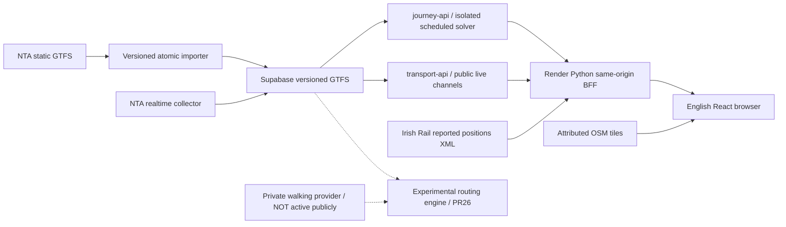

> Current13October2026 technical preview: published source `06b72b428fa623e7daf4d244b4851683506b78d0`, Render deployment `dep-db7b4uad0e5s73fv1i4g`, journey-api version4, main `f38826625e08fe6bcd92073df45685fa36bbf7cf`. The owner-approved preview update passed actual public-browser verification; see [PROGRESS](PROGRESS.md) and [published evidence](evidence/technical-preview-20261013/README.md). Regional NO-GO remains. Previous sections are historical phase evidence; do not repeat completed publication/rollback steps without fresh specific approval.

# Architecture and trust boundaries

Browser has no API management/service key, private JWT or provider adapter. Only server holds publishable transport key. Management bindings target their respective API hosts; not copied to browser/GitHub. The publishable key is not a private consumer credential. Same-origin/CORS restrictions do not stop direct nonbrowser abuse. Global BFF60/min and Edge30/min are preserved emergency quotas, not consumer fairness.

The public solver and A12 are different implementations. Public schedules use supplied GTFS times, calendar exceptions and same-stop connection buffers; no walking or realtime reconciliation. A12 has private provider geometry/budgets but no validated physical access or target-host release proof. Do not replace the public tree with an old A12 branch or toggle walkingIncluded without a new validated contract.

Live bus GPS ages use observation timestamps; Irish Rail reports have unknown precision/observation time. Source retrieval time is never an ETA. Gateway limits clients/workers/bytes/time, refuses upstream redirects and exposes only sanitized DTOs. Free Render can idle. Existing immutable update pipeline has no auto-deploy; dry local tests do not establish a rollback rehearsal.
